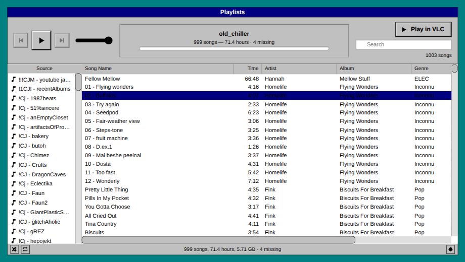
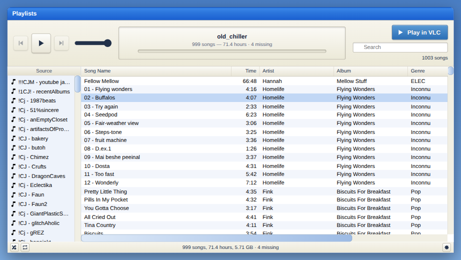
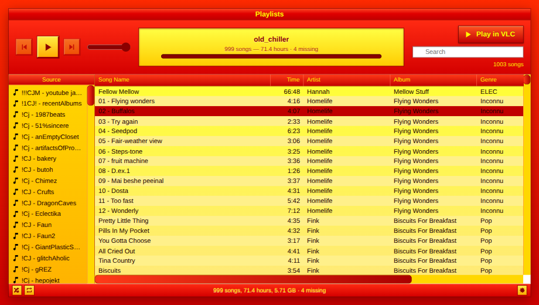
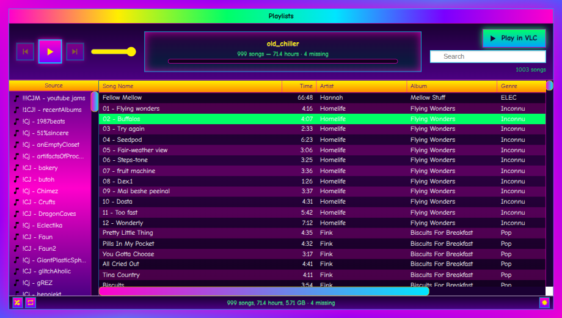

# you_tunes_browser

**The playlists survived. The paths didn't.**

Point it at your iTunes library export and the drive your music ended up on. It
finds the files, writes a `.m3u8` per playlist, and gives you a local page to
browse and play them in something that looks like the iTunes you made them in.


## The problem

An iTunes library XML stores an absolute path for every track. Move the music to
another drive or another machine and every one of those paths is wrong. The
audio is right there; the playlists — often the only surviving record of how a
collection was organised — point at nothing.

Most exporters assume those paths still resolve. The ones that do remap stop at
a prefix swap, which handles the tracks that never moved and silently breaks the
ones that did.

## What it does

Three ways of finding each of your tracks, tried in order:

1. Rewrite the recorded path prefix onto wherever your music lives now.
2. Failing that, look the bare filename up across your library and take a single
   unambiguous match.
3. Still nothing? When several files share a name like `01 Track 1.mp3`, take
   the one whose byte size matches what the library recorded.

Whatever is still unresolved is counted and shown in the page — never guessed
at, never quietly dropped.

How much the last two steps buy you depends entirely on how your collection was
reorganised over the years. On the one library this has been run against, they
were the difference between 95.9% and 98.4%:

```
13,418 playlist entries across 174 playlists
  12,868  found by prefix swap alone
     325  found elsewhere by filename
      16  disambiguated by byte size
     209  genuinely not on the drive
```

Those 341 middle entries are the ones a prefix-only tool turns into broken
links without telling you.

## Setup

```bash
python -m venv .venv
source .venv/bin/activate
pip install -e ".[dev]"
```

Put your library export at `data/iTunes Music Library.xml`, then set the two
paths in `config.toml`:

```toml
[music]
recorded_root = "/Users/you/Music/iTunes/iTunes Media/Music"   # what your XML says
local_root    = "/mnt/archive/Music"                           # where it is now
```

`recorded_root` is the `Music Folder` value inside your XML.

## Use

```bash
python make_playlists.py    # one .m3u8 per playlist
python build_browser.py     # build the page
python serve.py             # serve it
```

Open the printed `http://127.0.0.1:<port>/`. The port is probed upward from
8000, so a server you forgot about doesn't stop the launch.

The `.m3u8` files stand alone. VLC, Rhythmbox and Navidrome all read them
without any of the rest of this. If your playlists are all you wanted, stop
after the first command.

### In the page

- **Double-click** a row to play it. Prev/next, a clickable scrubber, volume.
- **Shuffle and repeat** bottom-left, where iTunes kept them. Repeat cycles
  off → all → one.
- **Sort** by any column; **search** filters by song, artist and album.
- **Play in VLC** hands over what is on screen, in the order shown. Sort by
  length, filter to one artist, play that.
- **Missing tracks** show greyed, with a `Found` column saying how each was
  located: `direct`, `moved`, `by size`, or `gone`.
- **View Options** — right-click the column headers. All 29 library fields, plus
  the derived `Found`: ratings as stars, bit rate, date added, BPM.

## Skins

Eight, from the gear in the bottom-right corner, remembered per browser.

| | | |
| --- | --- | --- |
| **Greenwood** | iTunes 1–4 | brushed metal, the default |
| **Tofino** | iTunes 5–6 | flat grey |
| **Kaslo** | iTunes 7–10 | blue sidebar |
| **Concrete** | Windows 3.1 | teal desktop, centred navy title |
| **Startup** | Windows 95 | the gradient title bar |
| **Chelan** | Windows XP | Luna blue and beige |
| **Boring** | Hot Dog Stand | red, yellow, black, no mercy |
| **Azalea** | MySpace 2006 | not an operating system at all |

<p>




</p>

Mac eras are named for towns in British Columbia, the rest for towns in
Washington and Oregon. All eight are real. Greenwood is
Canada's smallest city, population 702. Boring is in Clackamas County, Oregon,
and yes, it is next to Damascus.

Boring's palette was sampled from a Program Manager screenshot rather than
memory, which corrected this project's own first attempt: title bars are red
with yellow text, not the reverse. It parts company with the original on the
grey — every control here is red or yellow, with gradients the 16-colour palette
could not have produced.

Only eras that kept this layout are offered. iTunes 11 hid the sidebar and 12
moved to a tab bar; their colours on this layout would be a costume, not a skin.

## How playback works

`GET /audio?i=<n>` streams a track with byte-range support, which is what makes
seeking work — Python's stock handler has none, so it is implemented here.

No decoder is involved. Browsers decode MP3 and AAC/M4A natively, which covers
most of a typical iTunes library. WAV, FLAC and the AAC variants get the right
content type, but none has been tested here. AIFF is the usual
holdout. Anything the browser refuses shows `Cannot play` on that track rather
than failing silently, and the VLC button is the fallback.

Both endpoints take **row numbers only, never paths**. The server maps them
through its own `paths.json`, which the page never receives, so neither can be
asked for a file outside your library. It binds to `127.0.0.1`.

## `tools/demangle.py`

Some archive copies arrive with every filename mangled — the real file saved
with `-2` appended, and an empty directory holding the name it wanted. A library
XML cannot resolve against a tree in that state.

```bash
python tools/demangle.py /path/to/music            # plan only, changes nothing
python tools/demangle.py /path/to/music --apply    # execute, journalling each rename
python tools/demangle.py --undo <journal>          # reverse it
```

It only acts on a pair whose target name is held by an **empty directory**, so a
file genuinely named `Track-2.mp3` is reported and skipped. `rmdir` clears the
placeholder and physically cannot remove a directory with anything in it. If the
plan contains any conflict, nothing runs at all.

## Limits

- Regular playlists only. Smart playlists, the master library list and empty
  playlists are skipped.
- Tracks whose files are genuinely gone stay gone. They are counted and shown,
  not invented.
- `data/` is gitignored. A library export is personal listening history.
- Python 3.11+ for `tomllib`. No dependencies outside the standard library.

## Status

**0.1.0 — alpha.** This has done its job once, on one large library, on Linux.
That is the whole body of evidence. There are 57 tests, 14 of them on
`demangle`'s four safety properties. But nobody has run it against a library
other than the one it was written for.

If yours was exported from Windows, or its `Music Folder` sits somewhere
unusual, expect the path remapping to need a nudge. That is the part most likely
to break first, and the part worth an issue if it does.

MIT.
