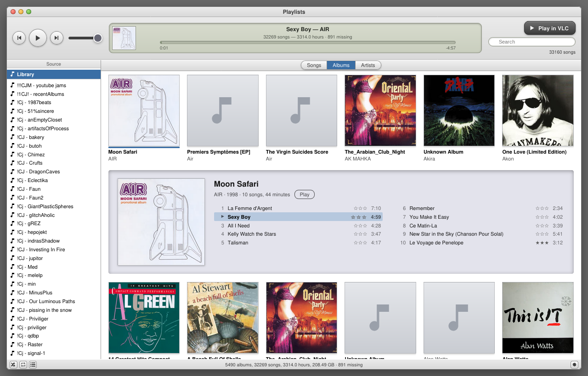
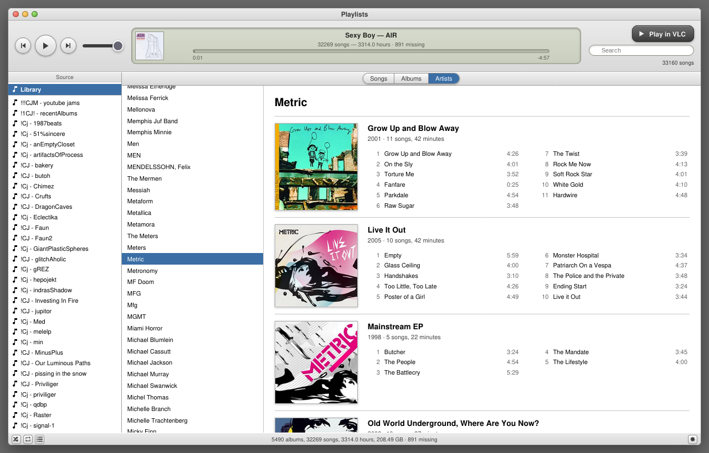
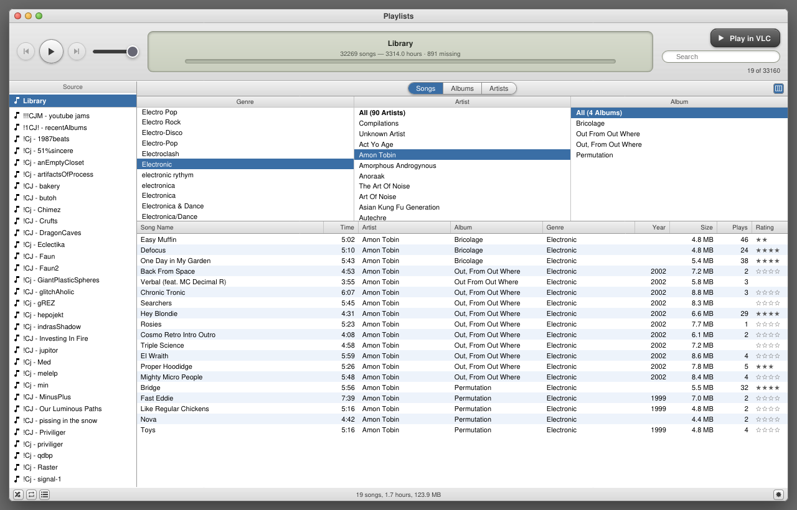

# orphan-tunes

### The playlists survived. The paths didn't.

Your iTunes playlists, rebuilt against the music files you still have. Plus a
local page to browse and play them in.


## Quick start

Needs Python 3.11+ and ffmpeg.

```bash
pip install -e .    # one dependency: itunessmart, which reads smart playlist rules
# copy your iTunes Music Library.xml into data/, then set the paths in config.toml
python make_playlists.py && python build_browser.py && python serve.py
```

`config.toml` wants four paths: the music folder your XML recorded, where that
music lives now, and where to write the playlists and the page.

## Why

Move your music to a new drive and every path in the library XML that iTunes
exports goes stale. The audio sits on disk while your playlists point at nothing.
Often they're the only record of how you organised any of it.

Swapping the old music folder for the new one at the front of each path finds
most files. Not the ones that moved to a different folder. So this one also
looks each filename up across your whole library, and when several files share a
name, it takes the one whose size matches what iTunes recorded. A tie it can't
break counts as missing.

On the one library it was built against, 13,418 entries in hand-made playlists,
the swap alone found 96.8%. The search took that to 98.9%. Those 285 entries
would otherwise have become dead links, quietly.

What it can't find, it shows you: greyed out, with the reason in a Found column
you can switch on.

## What you get

- **Plain `.m3u8` playlist files.** Tested with VLC; any player that reads m3u8
  should take them. If that's all you wanted, stop after `make_playlists.py`.
- **A browsable page.** Your whole music library and your playlists, with
  sorting, search, 31 library fields as columns, and a column browser.
- **Smart playlists.** Yours come back as the lists iTunes saved. Duplicate one
  and its rules run again, live. Or make a new one.
- **Plays and ratings that count.** Play a track to its end, or click its stars,
  and `serve.py` saves it.
- **Album and artist views**, iTunes 11 style, with covers taken from the
  artwork embedded in your files.
- **Playback in the browser**, with Up Next, media keys and keyboard control. Or
  send what's on screen to VLC, in the order shown.

## Songs, albums, artists



Click a cover and its tracks open under its row, tinted from the art.
Double-click a track to play it.



Artists, grouped by Album Artist. Compilations all sit under one entry,
Compilations, so each guest artist on one doesn't get an entry of their own.



Songs, with the Genre | Artist | Album browser on (Ctrl+B). Solid stars are
ratings you set. Hollow ones are what iTunes worked out from the album's rating.

## Eight skins


Three iTunes eras, three Windows eras, Windows 3.1's Hot Dog Stand colour
scheme, and a 2006 MySpace band profile. Pick from the gear in the corner.

They're named for real towns in British Columbia, Washington and Oregon, which
is how a Windows 3.1 tribute ends up called Concrete. Boring is a real town too.
It's next to Damascus.

Every skin is built from colour values written from scratch.

## Status

**0.2.0 alpha.** It has only ever run against one large library, on Linux.
There are 146 tests, but nobody has yet pointed it at a library other than the one
it was written for. That's the whole body of evidence.

If yours came off Windows, the path remapping is untested there, and it's the
part most likely to break. Worth an issue if it does.

---

Not affiliated with, endorsed by, or sponsored by Apple Inc. or Microsoft
Corporation. iTunes is a trademark of Apple Inc.; Windows is a trademark of
Microsoft Corporation. This reads library files you already own and contains no
code or assets from either company.

[How it works](docs/how-it-works.md) · Python 3.11+, ffmpeg and one Python dependency · MIT
