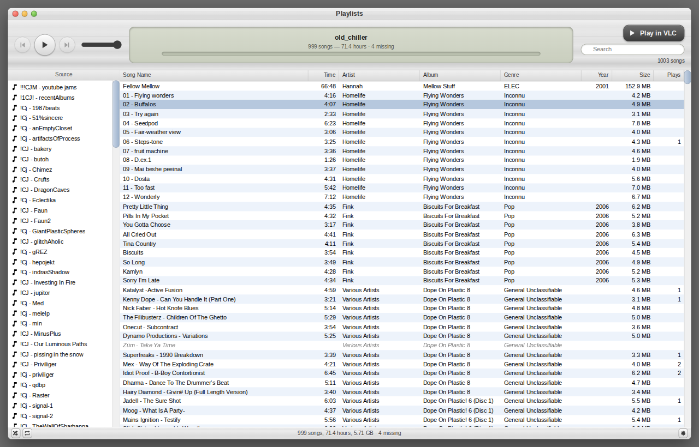
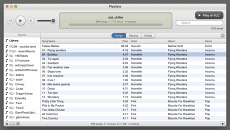

# orphan-tunes

### The playlists survived. The paths didn't.

Your iTunes playlists, rebuilt against the music files you still have. Plus a
local page to browse and play them in.



## Quick start

```bash
python -m venv .venv && source .venv/bin/activate && pip install -e ".[dev]"
# drop your library export in data/, set two paths in config.toml
python make_playlists.py && python build_browser.py && python serve.py
```

## Why

Move your music to a new drive and every path in that XML goes stale, so the
audio sits on disk while your playlists point at nothing. Often they're the only
record of how you organised any of it.

Most exporters do a prefix swap and call it done. This one also hunts by
filename across your library, and settles ties by comparing file size against
what iTunes recorded. On the one library it was built against, that took 95.9%
up to 98.4%. Those 341 entries would otherwise have become dead links, quietly.

What it can't find, it shows you. Greyed out, with the reason.

## What you get

- **Plain `.m3u8` files.** Tested with VLC; any player that reads m3u8 should
  take them. If that's all you wanted, stop after the first command.
- **A browsable page.** Sort, search, 29 library fields as columns.
- **Playback in the browser**, or hand the current view to VLC in the order shown.
- **Eight skins**, because why not.

## Eight skins



Three iTunes eras, three Windows eras, one Hot Dog Stand, and one 2006 band
profile. Pick from the gear in the corner.

They're named for real towns in British Columbia, Washington and Oregon, which
is how a Windows 3.1 tribute ends up called Concrete. Boring is a real town too.
It's next to Damascus.

Every skin is built from colour values written from scratch. No Apple or
Microsoft artwork, icons or fonts are copied or shipped.

## Status

**0.1.0 alpha.** This has worked exactly once, on one large library, on Linux.
There are 57 tests, but nobody has yet pointed it at a library other than the one
it was written for. That's the whole body of evidence.

If yours came off Windows, expect the path remapping to need a nudge. It's the
part most likely to break. Worth an issue if it does.

---

Not affiliated with, endorsed by, or sponsored by Apple Inc. or Microsoft
Corporation. iTunes is a trademark of Apple Inc.; Windows is a trademark of
Microsoft Corporation. This reads library files you already own and contains no
code or assets from either company.

[How it works](docs/how-it-works.md) · Python 3.11+, no dependencies · MIT
